# Finch: Sparse Arrays for Python

## Sparse Array Definition

A sparse array is an array where most entries are blank. Usually, these blanks are represented by 0 or some other, selected value. Sparse arrays provide asymptotic time and space complexity benefits compared to dense arrays for some classes of problems.

## Finch Advances the Ecosystem

| Feature / Tool                      | Finch     | Scipy Sparse | PyData Sparse |
| :---                                | ---:      | ---:         | ---:          |
| Sparse Array Operations and Formats | &check;   | &check;      | &check;       |
| Tensor Support                      | &check;   | &cross;      | &cross;       |
| Optimizing Compiler / Scheduler     | &check;   | &cross;      | &cross;       |
| Custom Sparse Array Formats         | &check;   | &cross;      | &cross;       |
| Binary operations supported on tensors of different formats | &check;   | &cross;      | &cross;       |

!!! warning "Stability Notice"
    Finch is *pre-alpha software*. Sparse array optimization is an active
    field of research, and sharp corners are present which may be confusing
    to users unfamiliar with theory of sparse array optimizations.

## Dimensionality

Previous work in the python ecosystem often restricts the user to only two dimensions worth of sparsity. Finch has no such restriction. This makes finch extremely powerful for a much broader class of problems.

### An optimizing runtime.

Finch is meant to handle large sparse programming problems, and has methods of optimizing operations
such as re-ordering iteration orders and matrix multiplications minimizing the use of work and resources.
Other runtimes often to do not optimize sparse problems, and are therefore slower than Finch.

### Extensibility

While many sparse array formats already exist, some computations may require a novel format, as certain problem may have attributes that can be more informative when represented in an uncommon way, not yet available in Finch's codebase. In other sparse array programming suites, this is quite limiting, as a new implementation for every operator must be provided, not only for the format with itself, but also with every other format it interfaces with. Finch, however, requires a couple definitions per type, which the finch library the generalizes to all the common operations, both with the novel data format, and with all existing data formats. This is an asymptotic reduction in the amount of work required to fully integrate and test a novel format.

Finch allows end-users to create their own sparse array data-types, and then automatically optimizes those sparse arrays to interface with all prior and future novel sparse array data structures.

## Multiple evaluation runtimes

Finch does not run purely in Python, or purely in a C context compiled for your operating system.

Finch can:

 - JIT a calculation to execute it much faster than standard python.
 - Generate, compile, and execute sparse programs in C code.
 - Generate and run MLIR, an intermediate code representation, which can take advantage of hardware specifics to optimize problem runtime.
 - Execute the calculation in Python, for debugging and when speed is not a priority.
