# Formats


As sparse arrays arise from various analogues and open problems, the most efficient way to represent a sparse array varies to a great extent.


## Dense Element Storage

Every index in a dense element array is mapped to a corresponding value in memory, with zeros (sparsity fill) expressed literally in the array. Numpy arrays are examples of dense element storage. This format expresses excellent reads and writes, but wastes memory bandwidth and can lead to excess calculations when the sparsity of a matrix is high.


## Sparse Coordinate Format (COO)

Sparse Coordinate format (COO) is perhaps the next most intuitive format in python. It can store arbitrarily many dimensions extremely intuitively. To construct one in let's say, two dimensions. This construction would require two arrays for the indexes and one array for the values.

To write a sparse coo into a dense format, the procedure is simple, given a rows, columns, and values array.

```py
for i in range(len(values)):
  dense[row[i], col[i]] = value[i]
```

Generalizations to higher domains follow naturally. For the more functional programming minded, COO storage could be constructed by first creating a list of tuples of `(row, col, value)`. Call this list `L`. From here the COO format can be implemented in python via:

```py
row, col, value = unzip(*L)
```

As COO must store the row and column values for each non-zero (non-fill) entry, it becomes more memory efficient when the array is less than 1/3 dense. However, this is not where efficiency gains begin, because memory access patterns compared to dense arrays are subpar. Some gains can be achieved by sorting the array, which helps slightly with reads, but does not help with writes to the array.




Note that the actual finch definition of COO is more general, and does not have row and column fields, as finch's COO implementation is not limited to only matrices.

## Sparse Hash Level


A sparse hash level creates a hashmap that maps indexes to values in an array. Because of it's lookup characteristics and storage mechanism, it can perform COO on certain workloads, particularly write heavy work loads, such as matrix multiplication outputs. It can sometimes be more efficient to first compute a result and store it in a sparse hash level, and then later transform that sparse hash level to another format such as CSR.

Sparse hash levels can be suitable for write-heavy workload, but the sparsity and disjoint memory can make them significantly slower than denser memory layouts for many sparse array operations.

## Compressed Sparse Row (CSR)

Compressed Sparse Row (CSR) format can often reduce the space required to store sparse formats, due to lack of duplication in coordinates, and can also accelerate reads due to better memory access patterns. CSR format is composed of three arrays. The first array is the value array, which stores the non-fill (more loosely, the non-zero) entries of the array in a flat, dense form. The second array is the column indices array, when converting a dense array to CSR, the column indices array records the column of every value in the dense array. The third array is the row ptr array, but essentially, it represents an array so that `ptr[r]..ptr[r+1]` slices into the column indices array. The difference between `ptr[r+1]` and `ptr[r]` computes how many non-zero values there are in that row, meanwhile, `col_indices[ptr[r]..ptr[r+1]]` represents the columns of entries in that row. This structure expresses the behavior of having each row map to a list of tuples of column and value, but it is important to note that in memory, the CSR format is storing it as provided above, not as tuples directly, as it would be less efficient.


Below is a visualization of a 4 X 5 sparse matrix in CSR format, with the second row highlighted to show how the pattern in arrays.



CSR can be directly indexed for each row, but cannot be directly indexed for each column. For row r, the lower bound on that row's data is `rl = row_ptr[r]` and the upper bound is `rh = row_ptr[r+1]`. The column indices are stored in `col_indicies[rl..rh]` and the values in that column are `values[rl..rh]`. The first value can be found at (`r`, `col_indicies[rl..rh][0]`, `values[rl..rh][0]`), the second in the row is stored at (`r`, `col_indicies[rl..rh][1]`, `values[rl..rh][1]`). Note that because CSR is a truly sparse array, the concept of a "second" value might not be index 1 in the matrix, so it must be looked up in the `col_indices[rl..rh]` array instead.

Note that CSR, as provided in the examples, can be more memory efficient than COO, and almost always will be when each row in the matrix has at least one value. Regardless of it's memory efficiency, CSR is a much more efficient for reads when compared to COO, and therefore is often a good choice for performing sparse array operations.

Note that CSR also has an sister format named CSC (compressed sparse column), which essentially just flips whether the top level array refers to rows or refers to columns. This is useful for certain operations, but most likely, CSR will be seen much more frequently.
